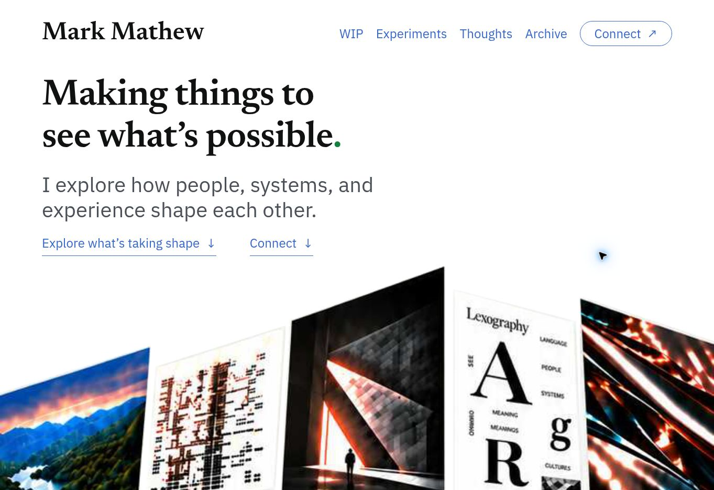

# Mark Mathew — personal website

A small static website for writing and interactive experiments, hosted with Cloudflare Workers Static Assets.

**[markmathew.com](https://markmathew.com/)** · **[The Counter](https://markmathew.com/experiments/the-counter/)**

The editorial desktop homepage uses Newsreader and IBM Plex Sans, an interactive artwork gallery, selected projects, and a directory with hover/focus previews. [Implementation and artwork notes](docs/editorial-desktop.md).



[Desktop validation](docs/editorial-desktop-qa.md)

The earlier homepage is preserved in [the original preview](docs/preview.png).

## Local development

Requires Node.js 24+ and npm. Clone the independent game beside this project:

```powershell
git clone https://github.com/markusimperative/the-counter.git
git clone https://github.com/markusimperative/markmathew-site.git
cd the-counter
npm ci
cd ../markmathew-site
npm ci
npm run build
npm run check
npm run check:cloudflare
npm run preview
```

Open `http://127.0.0.1:8787/`. The preview binds loopback and uses no remote bindings. `check:cloudflare` is a dry run and publishes nothing. While preview runs, `npm run check:preview` checks served runtime hashes, headers, redirects and unavailable private/API paths. Stop preview before rebuilding; start it again afterward.

To test the game itself, run `npm test` and `npm run lint` in the sibling `the-counter` folder. No credentials or account login is needed for local builds or play.

The [browser test suite](tests/README.md) covers portfolio destinations, keyboard navigation, the Connect dialog, responsive layout, screenshots, and axe-core accessibility checks.

## Structure

- `site/` contains the homepage, About, WIP, Experiments, Thoughts, Archive, Connect, and shared styles and assets.
- `scripts/build.mjs`: builds the independent game for `/experiments/the-counter/` and copies only its runtime into `dist/`.
- `scripts/check.mjs`: checks internal references, copy integrity, allowed runtime files and size limits; writes an ignored release manifest.
- `wrangler.jsonc`: local static preview configuration.
- `wrangler.production.jsonc`: production Worker/custom-domain configuration; this public copy omits the owner's account identifier.
- `wrangler.staging.jsonc` and staging scripts: separate local candidate preparation and dry-run checks; they do not change hosted Access policies.

The game source is not merged into this repository. The website consumes its runtime only. No backend, response collector, analytics, participant records or credentials enter `dist/`. Existing public Notes links remain `https://markmathew.substack.com`.

## Deployment and publication

Production uses the existing `markmathew-site` Worker and exact `markmathew.com` Custom Domain. WWW redirects to HTTPS apex. An authorized maintainer must verify the account, current version and domain binding before using the production configuration. The local production configuration remains authoritative; its owner account ID is intentionally not published. There is no automatic deployment or GitHub Pages workflow.

This is a clean public source snapshot. Internal deployment reports, private staging URLs and Access details, DNS/email audits, screenshots of administration pages, ZIP exports, caches, response data and original local Git history were excluded. The live website and protected staging remain separate. [Deployment notes](docs/deployment.md).

**No open-source license has been assigned.** Public inspection does not grant a separate general reuse license. Game artwork, recordings and their provenance remain in the independent [The Counter repository](https://github.com/markusimperative/the-counter).
